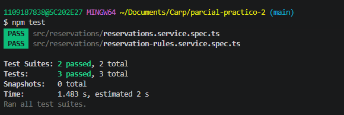

# Resultados del parcial práctico 2

Registrar resultados reales después de implementar y probar los endpoints. Sustituir los IDs de ejemplo por los utilizados.

| Petición y datos utilizados | Código esperado | Código obtenido | Observación |
| --- | --- | --- | --- |
| Crear una reserva con datos válidos y sala existente. | 201 | 201 | |
| Crear con participants como texto. | 400 | 400 | |
| Crear con una propiedad adicional, como status. | 400 | 400  | |
| Crear con una sala inexistente. | 404 | 404 | |
| Cancelar una reserva activa y consultar el cambio guardado. | 200 | 200 | |
| Cancelar de nuevo la misma reserva. | 409 | 409 | |
| Intentar cancelar con ID abc. | 400 | 400 | |
| Intentar cancelar con un ID entero inexistente. | 404 |  404 | |

## Pruebas unitarias

Registrar el resultado de `npm test`.

| Caso | Resultado obtenido |
| --- | --- |
| 1. La regla real rechaza una reserva cancelada. | Pendiente |
| 2. El servicio cancela y guarda una reserva activa. | Pendiente |
| 3. Si la regla simulada rechaza, conserva active y no guarda. | Pendiente |

Resumen de ejecución: pendiente.
